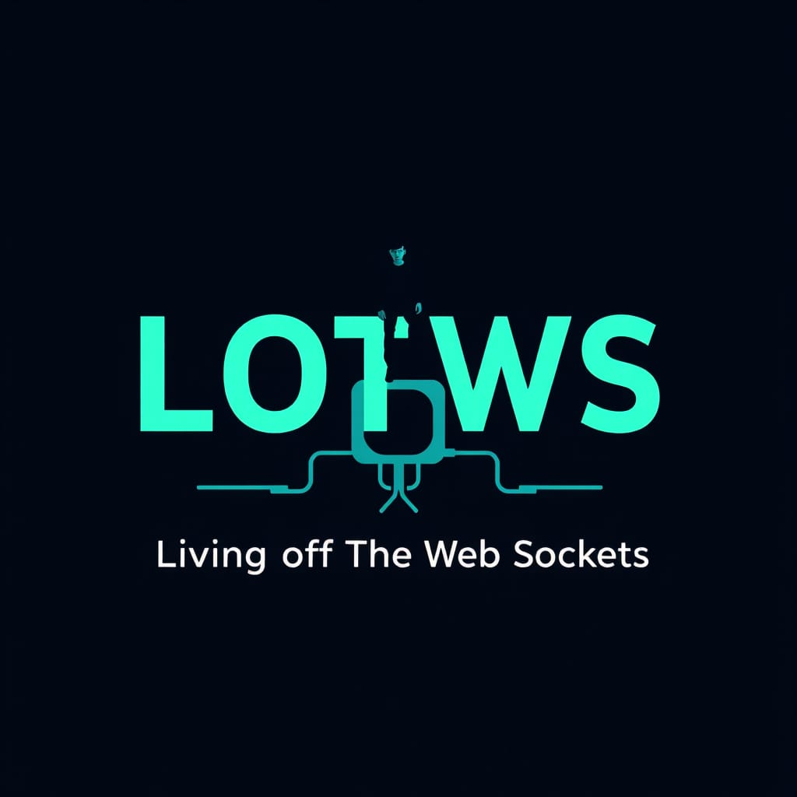

# LOTWebSockets

<p align="center">
  
</p>

**A community-maintained, defender-focused reference of WebSocket services and endpoints that may be abused for command and control (C2), tunneling, or data exfiltration.**

Browse the catalog at **[lotwebsockets.github.io](https://lotwebsockets.github.io/)**.

> **Use responsibly.** This project documents potential abuse patterns to support security research, threat awareness, and defensive monitoring. It is not an invitation or authorization to access services, accounts, or data without permission. Follow applicable laws, service terms, and your organization's policies.

## What you'll find

The home page catalogs WebSocket-related services and patterns. Use the search field to find entries, or download the generated [CSV](./data/websockets.csv) for analysis.

Each entry includes:

| Field | Description |
| --- | --- |
| **Websocket Name** | Service or pattern being described |
| **Endpoint** | A WebSocket URL or endpoint template; placeholders are illustrative |
| **Abuse** | A brief description of the potential abuse pattern |
| **Status** | The evidence or implementation status recorded for the entry |

Statuses such as **Documented**, **PoC**, **Concept**, and **Unofficial** describe the entry's stated evidence or implementation context. They are not guarantees that an endpoint is currently available, safe to test, or operated by the project.

## Project pages

- [Catalog](https://lotwebsockets.github.io/) — browse and search the entries.
- [About](https://lotwebsockets.github.io/about.html) — project context and contribution overview.
- [Contributors](https://lotwebsockets.github.io/contributors.html) — people involved in the project.

## Contributing

Contributions that improve accuracy, clarity, and defensive value are welcome. Please open an issue first if an addition is substantial or its scope is unclear.

1. Fork this repository and create a branch for your change.
2. Search the catalog to check whether the entry already exists.
3. Add or update a row in the `#sockets` table in [`index.html`](./index.html). Keep the four columns in order: name, endpoint, abuse, and status. Follow the existing HTML and status-badge conventions.
4. Keep endpoint templates clearly illustrative. Do not include credentials, private data, or instructions to access systems without authorization. Where possible, include enough context in the entry or pull request description for reviewers to verify the claim.
5. Preview the site locally and check that the table remains readable and searchable:

   ```sh
   python3 -m http.server 8000
   ```

   Then open <http://localhost:8000/> in a browser. Stop the server with `Ctrl+C` when finished.

6. Open a pull request describing what changed and, where applicable, linking to supporting sources.

### Generated files

[`data/websockets.csv`](./data/websockets.csv) and [`data/badge.json`](./data/badge.json) are generated from the catalog in `index.html`. After a change to `index.html` reaches the `main` branch, the GitHub Actions workflow regenerates these files and commits any updates. **Do not edit the generated files by hand** when changing catalog entries.

To regenerate them locally, install the generator's dependency and run the script:

```sh
python3 -m pip install beautifulsoup4
python3 scripts/generate_csv.py
```

## Repository layout

| Path | Purpose |
| --- | --- |
| [`index.html`](./index.html) | Main site and source of truth for catalog entries |
| [`about.html`](./about.html) | Project background and contribution overview |
| [`contributors.html`](./contributors.html) | Contributor page |
| [`assets/`](./assets/) | Images, favicon, and site styles |
| [`LICENSE`](./LICENSE) | CC BY 4.0 license terms |
| [`data/websockets.csv`](./data/websockets.csv) | Generated, downloadable catalog data |
| [`data/badge.json`](./data/badge.json) | Generated entry-count badge data |
| [`scripts/generate_csv.py`](./scripts/generate_csv.py) | Generates the CSV and badge from `index.html` |
| [`.github/workflows/update-csv.yml`](./.github/workflows/update-csv.yml) | Updates generated data when catalog changes reach `main` |

## Contact

For project questions or proposed changes, please open a [GitHub issue](https://github.com/LOTWebSockets/LOTWebSockets.github.io/issues). You can also connect with [Kamran Saifullah on LinkedIn](https://linkedin.com/in/kamransaifullah).

## License and attribution

Unless a file or item says otherwise, this repository's original content is licensed under the [Creative Commons Attribution 4.0 International license (CC BY 4.0)](./LICENSE). You may share and adapt that material, including for commercial purposes, provided you give appropriate credit, link to the license, and indicate whether you made changes. You may not imply that Kamran Saifullah or the project endorses you or your use.

When you share or adapt material from this project, include a credit such as:

> “Based on [LOTWebSockets](https://github.com/LOTWebSockets/LOTWebSockets.github.io) by Kamran Saifullah, licensed under [CC BY 4.0](https://creativecommons.org/licenses/by/4.0/). Changes made: [describe changes].”

Adapt the format to the medium, but keep the attribution and license link reasonably accessible. The attribution condition applies when you share the licensed material; it does not require a public citation for private use that is not shared.

The license applies only to material the project has the right to license. Third-party names, logos, content, and linked services may belong to others and are not covered by this license. The license does not grant trademark rights or permission to access or test any service. See [`LICENSE`](./LICENSE) for the complete terms.
